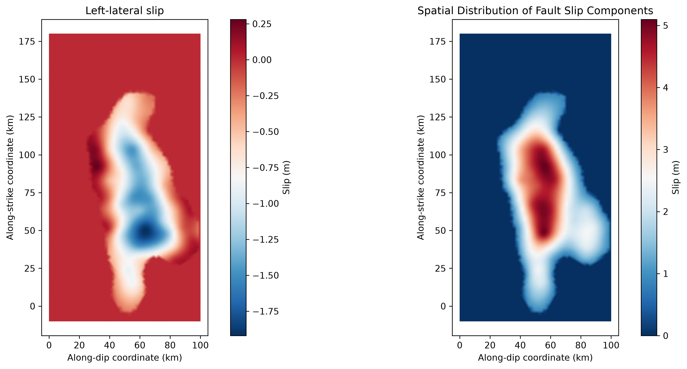
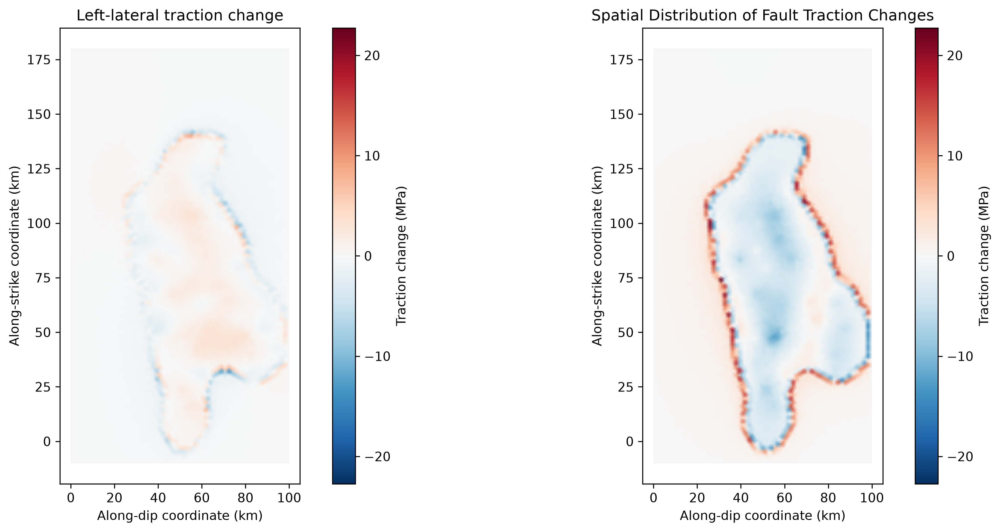
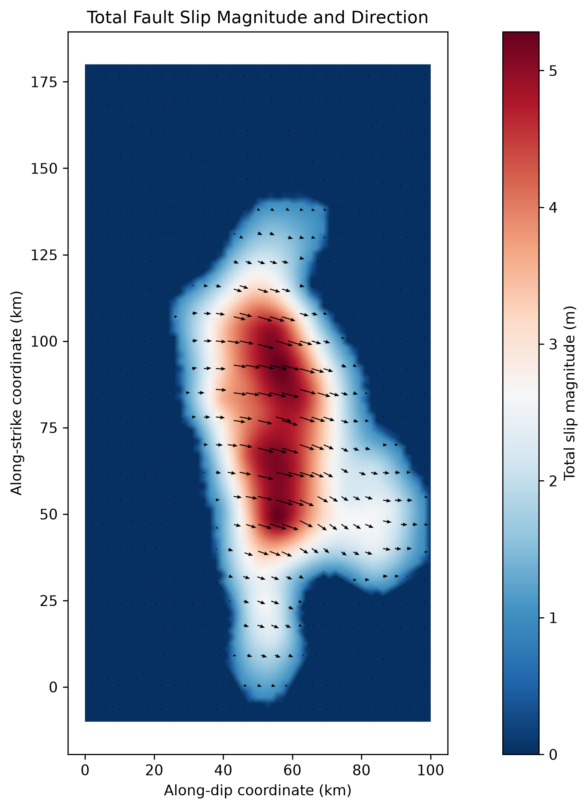
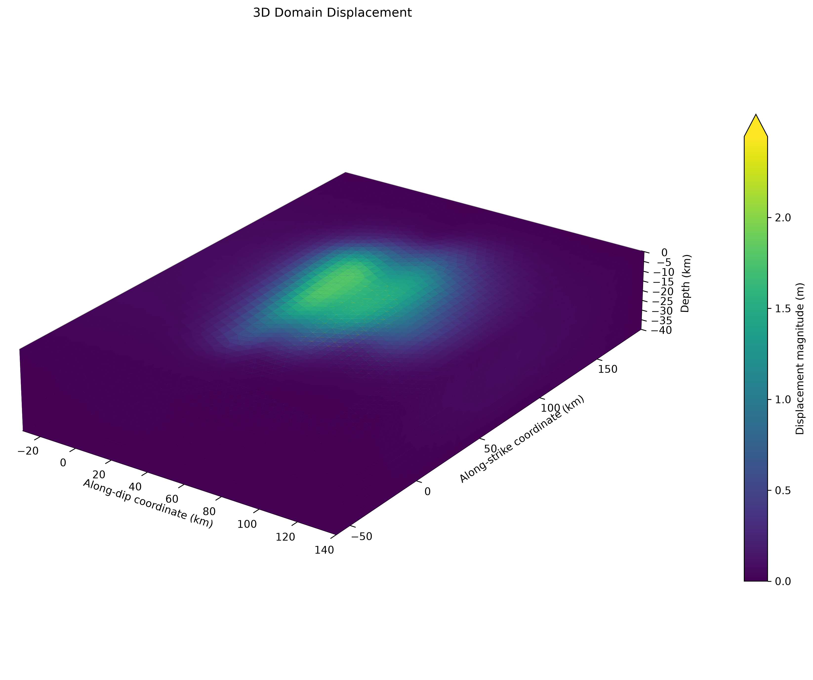

# NUMERICAL MODELING OF FAULT DEFORMATION USING PYLITH

Independent Research Project

## 1. Project Overview

This project is an independent exploration of computational geophysics, focusing on the numerical modeling of fault deformation using PyLith.

This project use an existing Nepal kinematic model configuration and used to run a static simulation. The resulting outputs were processed and visualized using Python to examine fault slip, traction changes, and displacement magnitude.

The project aims to develop practical experience in computational geophysics and gain a better understanding of how numerical simulations can be used to investigate earthquake-related deformation processes.

## 2. Research Objectives

The main objectives of this project are to:

1. Explore the application of numerical modeling in computational geophysics using Pylith.
2. Examine the spatial distribution of fault slip and traction changes.
3. Develop a Python-based workflow for processing and visualizing geophysical simulation outputs.
4. Gain practical experience in scientific data processing and visualization.

## 3. Methodology Overview

The project consists of the following stages:

1. Model setup and numerical simulation: Examined the existing Nepal kinematic model configuration as well as its supporting files and executed the simulation using PyLith.
2. Output extraction: Used Python and h5py to access relevant fields stored in the generated HDF5 files.
3. Data processing: Used NumPy to process simulation fields and calculate total slip magnitude from the available slip components.
4. Scientific visualization: Used Matplotlib to visualize fault slip, traction changes, slip vectors, and three-dimensional domain displacement.
5. Result exploration: Examined the spatial patterns represented in the simulation outputs and considered the limitations of the model.

## 4. Results and Visualizations

The following visualizations present selected outputs from the PyLith simulation.

1. Fault Slip Distribution

  

o Left-lateral slip (m)
o Updip slip (m)

These plots provide a view of how the simulated slip components vary across the fault surface.

2. Fault Traction Change

  

o Left-lateral traction change (MPa)
o Updip traction change (MPa)

The spatial distributions illustrate variations in the traction components across the modeled fault surface.

3. Total Fault Slip Magnitude and Vectors

  

Combines total slip magnitude with slip vectors to visualize the magnitude and direction of simulated fault movement.

4. Three-Dimensional Domain Displacement

  

Visualizes the displacement magnitude within the three-dimensional computational domain, providing a spatial view of the simulated deformation.

Figures are available in: results/

## 5. Tools and Libraries

o Pylith
o Python
o NumPy
o h5py
o Matplotlib

## 6. Limitations

This project uses an existing model configuration and prescribed fault-slip distribution. It is a static simulation rather than a dynamic earthquake rupture simulation.

The results are model-derived and have not been independently validated against observational datasets.

Further work could involve examining parameter sensitivity, comparing modeled deformation with observational datasets, and exploring additional aspects of earthquake-related fault behavior.

## 7. Data Sources

The original Nepal model configuration and associated resources are available from:

https://cuseistut.readthedocs.io/en/latest/pylith_static/

The HDF5 simulation outputs analyzed in this project were generated by running the model with PyLith.

Python scripts developed for output extraction, processing, and visualization are included in this repository.

Original model resources are referenced rather than reproduced in full. Please consult the original source for their availability and usage conditions.

## 8. Author

Independent research project in seismology and computational geophysics, with an interest in numerical modeling, scientific computing, and earthquake-related deformation processes.

## 9. References

1. Computational Infrastructure for Geodynamics (CIG). Nepal Kinematic Model Resources. https://cuseistut.readthedocs.io/en/latest/pylith_static/
2. PyLith Documentation. https://pylith.readthedocs.io/
3. h5py Documentation. https://docs.h5py.org/

*This project represents an independent exploration of computational geophysics through numerical simulation, scientific data processing, and visualization using PyLith and Python.*